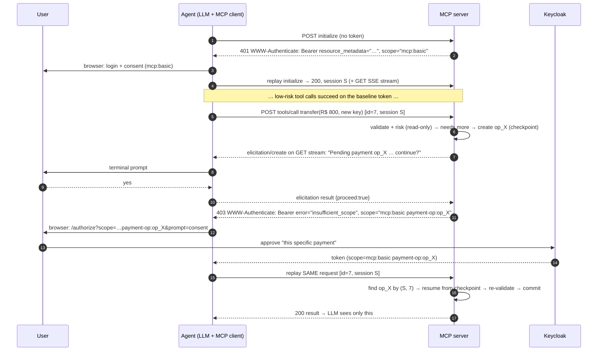

# MCP step-up lab: `WWW-Authenticate` mid-interaction

A docker compose workspace to validate this proposal: **an MCP tool finds out _while running_ that the caller's grant is not enough and answers with an HTTP `403` + `WWW-Authenticate: Bearer error="insufficient_scope"`. The client holds the in-flight request, gets a stepped-up token, and replays the same request. The tool doesn't advertise the requirement up front, and elicitation is never the authorization mechanism.**

The lab also makes the replay **safe**:

* **Atomic 403.** A challenge means nothing was executed. A commit guard enforces it.
* **Pending operations.** The server checkpoints the operation, so the replay resumes it instead of starting over, and a duplicate replay returns the stored result.
* **Operation-bound step-up.** The new token carries `payment-op:<operation-id>`, so it authorizes that payment only.
* **Pre-step-up elicitation.** Before the browser redirect, the user sees what is pending and confirms they want to continue.

| Component | Path | Role |
|---|---|---|
| **IdP / AS** | `idp/` | Keycloak 26.8, realm `mcp`, scope `mcp:basic` (baseline), parameterized scope `payment-op:<id>` (per-operation step-up) |
| **MCP server** | `mcp-server/` | Streamable HTTP resource server (TS SDK 1.32), toy Pix bank, RFC 9728 metadata, pending-operation store |
| **Agent** | `agent/` | Claude tool-use loop over an MCP client that answers form elicitation and transparently handles Bearer challenges |



---

## Step 0: prerequisites

* Docker Desktop (Compose v2.24+, for `env_file.required`)
* An Anthropic API key (for the agent only; the curl probe doesn't need it)
* Ports 8080, 3000 and 8765 free on the host

```bash
cp .env.example .env     # put your ANTHROPIC_API_KEY in it
```

## Step 1: the IdP (`idp/realm-mcp.json`)

Keycloak imports the realm at boot (`start-dev --import-realm`). What matters in it:

* **`mcp:basic`** is a default scope: baseline access to the MCP server.
* **`payment-op`** is a **parameterized scope** (preview feature `parameterized-scopes`, enabled in compose), so clients request `payment-op:<operation-id>`. The token's `scope` carries the exact operation id, which binds the step-up to **one** pending operation instead of a broad "elevated" grant. Both scopes carry an **audience mapper** that adds `aud = http://mcp-server:3000/mcp`. Keycloak ignores RFC 8707 `resource`, so the mapper stands in for it.
* **`mcp-agent` client.** Public, auth code + PKCE S256, redirect `http://localhost:8765/callback`, `consentRequired: true`. The agent sends `prompt=consent` on every step-up, so the user approves each operation even though Keycloak remembers consent for the `payment-op` scope family.
* **`mcp-probe` client.** Lab-only password grant, so `scripts/probe.sh` can run headless.
* **User:** `alice` / `alice`. **Admin console:** http://localhost:8080 (`admin` / `admin`).
* **Hostname split.** `KC_HOSTNAME=http://localhost:8080` plus `KC_HOSTNAME_BACKCHANNEL_DYNAMIC=true`. Tokens always say `iss=http://localhost:8080/realms/mcp`, while containers call token/JWKS on `http://keycloak:8080`. The agent maps front-channel to back-channel URLs with `BACKCHANNEL_REWRITE`.

## Step 2: the MCP server (`mcp-server/src`)

| File | What it does |
|---|---|
| `auth.ts` | Validates JWTs (iss, aud, signature via JWKS) on **every** HTTP request and requires `mcp:basic`. With no token it returns `401` plus `resource_metadata`. Serves PRM, which on purpose advertises only `mcp:basic`. |
| `stepup.ts` | `requireScopes()` records a challenge in an `AsyncLocalStorage` scoped to the HTTP request and aborts the tool. **`commit(label, fn)`** wraps every side effect. **Guard:** once something was committed in the request, `requireScopes()` refuses to produce a 403 and throws `StepUpAfterCommit` instead. The challenge scope is the client's current scopes, minus stale `payment-op:*`, plus what's needed. |
| `operations.ts` | **Pending-operation store**, keyed by `(Mcp-Session-Id, JSON-RPC id)`, which the client reuses on replay. Holds the operation id, args hash, checkpoint (risk result), status (`awaiting_confirmation → awaiting_step_up → completed / cancelled / failed`), the stored result and a TTL. |
| `tools.ts` | `transfer`: on first run it validates and evaluates risk (read-only). High risk creates `op_X` and then **elicits** confirmation. The user declining yields a normal tool result ("cancelled, nothing executed") with no 403. On proceed, `requireScopes(payment-op:op_X)`. On replay it finds `op_X`, checks that sub and args hash match, **resumes from the checkpoint** (no second risk call or elicitation), re-validates the balance and commits. If `op_X` is already completed, it returns the stored result (**idempotent**). `naive_batch_transfer` is a deliberately badly-ordered demo tool that commits item by item: the guard fires, and it reports partial progress **in-band**. |
| `index.ts` | `WebStandardStreamableHTTPServerTransport` with **`enableJsonResponse: true`**. If a challenge was recorded, it replaces the JSON-RPC response with `403` + `WWW-Authenticate` and a JSON-RPC error body with the same `id` and `operation_id`. Each session is bound to the `sub` that opened it. |

## Step 3: the agent (`agent/src`)

| File | What it does |
|---|---|
| `stepup-fetch.ts` | **The client half of the proposal.** A `fetch` passed to `StreamableHTTPClientTransport`. On `401`, or on `403` with `insufficient_scope`, it runs OAuth and **replays the identical HTTP request** (same JSON-RPC id, same session). Loop guards are in place. If the user denies, the original `403` goes up to the MCP layer. |
| `oauth.ts` | Challenge → PRM → OIDC discovery (checks the issuer) → auth code + PKCE with `resource` → token. On a 403 it uses the **server's challenge scope as-is** (it's authoritative and already drops stale op scopes) and adds `prompt=consent`. Single-flight. One callback listener keyed by `state`. |
| `elicitation.ts` | Form-mode elicitation handler: prints the server's message and asks in the terminal (`Y/n/c`). |
| `index.ts` | Claude tool-use loop. Declares the `elicitation: { form: {} }` capability. MCP requests use a **5 min timeout**, because a held request waits on a human. |

## Step 4: run it

```bash
docker compose up -d --build          # keycloak + mcp-server (agent is behind a profile)
docker compose ps                     # wait for both to be healthy

bash scripts/probe.sh                 # raw-HTTP proof, no LLM (see below)

docker compose run --rm --service-ports agent
```

`probe.sh` declares no elicitation capability, so the server skips the confirmation step. It shows:

* 401 with no token, then a low-risk call returning 200.
* A high-risk call: 403 with `scope="mcp:basic payment-op:op_…"`, then the replay with an op-bound token returning 200.
* The **same replay again**, which returns the stored result with no second debit.
* A **different** high-risk call, which gets a new 403 because the op-bound token doesn't cover it.
* `naive_batch_transfer`, where the guard turns the would-be 403 into a partial-progress result.

In the agent REPL:

1. Log in at the printed URL (`alice` / `alice`) and consent to "read your accounts".
2. `send R$ 50 to bob@pix.example from checking`: low risk, executed directly.
3. `send R$ 800 to carol@pix.example from checking`: the terminal shows **`[elicitation] Pending payment op_… continue?`**. Answer `n`: Claude reports that it was cancelled and nothing happened.
4. Ask again and answer `y`. You get a browser link for **this payment**: approve it and the same call completes. The server log shows `resumed from checkpoint`.
5. Ask again, answer `y`, and click **No** at Keycloak. The tool call fails cleanly and the balance is unchanged.
6. `do a naive batch from checking: R$ 20 to bob@pix.example and R$ 900 to zed@pix.example`: you get a partial-execution report from the guard.

Logs: `docker compose logs -f mcp-server` shows `[op]` lifecycle lines, `[guard]`, risk decisions and the 403 rewrite.

## What this lab surfaced (input for the proposal)

1. **Atomic-403 rule (normative candidate).** A server MUST NOT send `insufficient_scope` for a request after committing side effects for it. This matches HTTP semantics (4xx = not processed) and is what makes client replay safe. Non-atomic work must report partial progress in-band (guard demo) or be split into prepare and commit steps.
2. **Replay identity = operation identity.** `(session, JSON-RPC id)` lets the server resume a checkpointed operation and dedupe replays. A spec should either bless this or add an explicit operation handle to the challenge (`operation_id` auth-param). The request id alone is weak across reconnects.
3. **Operation-bound authorization.** A broad elevated scope lets later high-risk calls pass silently until the token expires. Binding the challenge to `payment-op:<id>` fixes that. The AS still only shows a generic consent text, though: it doesn't know the payment details. **RAR (RFC 9396) `authorization_details`** in the challenge would let the AS render "R$ 800 to carol@…". Keycloak's parameterized scopes are a stand-in.
4. **Elicitation and the 403 fight over the transport.** Elicitation is a server-to-client request. On a per-request SSE stream it would commit `200` before the 403 decision. In JSON response mode the POST has no stream for server requests, and the SDK silently drops a request-related one. The lab therefore sends the elicitation **unrelated** (no `relatedRequestId`), on the standalone GET SSE stream. That works, but it depends on the client keeping the GET stream open, and it loses the request association the spec recommends. A spec-level answer: allow request-related server messages to travel on the GET stream while a JSON-mode POST is pending, or define the challenge in-band.
5. **Elicitation is UX, not authorization.** It conveys "something is in course" and gives a cheap early exit (decline means no redirect and no 403). The authorization itself still comes from the AS.
6. **Status-line timing.** Same root cause as item 4: in SSE mode the HTTP challenge is impossible after the tool starts.
7. **Timeouts.** Held requests wait on a human (elicitation + browser). The SDK's 60 s default is too short. The client should raise it, or the server should send progress.
8. **SDK behaviour today (TS SDK 1.32).** The built-in `authProvider` upscoping throws `UnauthorizedError` on an interactive redirect, so the tool call fails. Hold-and-replay keeps the step-up invisible to the model.
9. **Session ↔ subject binding.** A step-up must not let another principal take over a session (`sub` check). `acr`/`auth_time` checks (RFC 9470) fit the same plumbing.

## Troubleshooting

* **`invalid_scope` for `payment-op:…`.** Keycloak started without `KC_FEATURES=parameterized-scopes`.
* **Elicitation never shows and the call hangs ~2 min.** The client's GET SSE stream isn't open, so the elicitation had nowhere to go (finding 4). The server times out and cancels the operation.
* **Agent can't reach `localhost:8080` for discovery.** That's expected inside a container. Keep `BACKCHANNEL_REWRITE` set.
* **`invalid_token: unexpected "iss"`.** Keycloak was reached through a hostname that changed the issuer. Keep `KC_HOSTNAME` as is.
* **Port 8765 busy.** Another agent run is still alive: `docker compose ps -a`.
* **Reset everything.** `docker compose down && docker compose up -d`. The realm is re-imported fresh, and the server's ledger and operations are in-memory.
