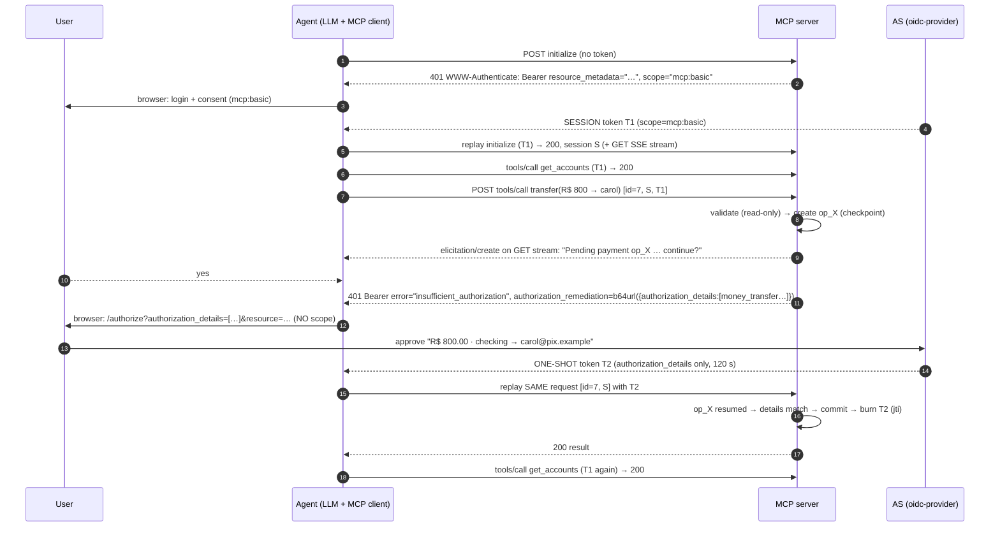

# MCP step-up lab: per-operation authorization with RAR remediation

> Versão em português (Brasil): [README.pt-BR.md](README.pt-BR.md)

A docker compose workspace to validate this proposal. **An MCP tool finds out _while running_ that the operation needs its own authorization, and answers with `401` + `WWW-Authenticate: Bearer error="insufficient_authorization", authorization_remediation=…`, as defined in [draft-ietf-oauth-rar-metadata-remediation](https://datatracker.ietf.org/doc/draft-ietf-oauth-rar-metadata-remediation/). The client holds the in-flight request, obtains a one-shot token carrying exactly the remediation's RFC 9396 `authorization_details`, and replays the same request.** The tool doesn't advertise the requirement up front, and elicitation is never the authorization mechanism.

* **Every transfer needs a `money_transfer` grant** whose `authorization_details` pin the debtor account, the creditor (Pix key) and the amount.
* **One-shot tokens.** The operation token carries **no scope** (no previous permission is re-requested), lives 2 minutes, and is burned by the MCP server (by `jti`) when the operation commits. The agent uses it for that single replay and discards it.
* **The session token is kept.** The `mcp:basic` token from login keeps serving balances and every other call. It is never replaced.
* **Atomic challenge.** A 401 means nothing was executed, and a commit guard enforces that.
* **Pending operations.** The replay resumes from a checkpoint, and a duplicate replay returns the stored result.
* **Pre-authorization elicitation.** The user sees what is pending and confirms before the browser redirect.

| Component | Path | Role |
|---|---|---|
| **IdP / AS** | `idp/` | [node-oidc-provider](https://github.com/panva/node-oidc-provider) 9.12 with RAR, the `money_transfer` type, a consent page that renders the payment, and the `authorization_details_types_metadata_endpoint` |
| **MCP server** | `mcp-server/` | Streamable HTTP resource server (TS SDK 1.32), toy Pix bank, RFC 9728 metadata, pending-operation store, RAR remediation |
| **Agent** | `agent/` | LLM tool-use loop (Claude, or a local model through an OpenAI-compatible API) over an MCP client that answers form elicitation and handles Bearer challenges (session and one-shot) |



A detailed PlantUML version is in `docs/stepup-sequence.puml`.

---

## Step 0: prerequisites

* Docker Desktop (Compose v2.24+)
* An Anthropic API key **or** a local model (see [Running with a local LLM](#running-with-a-local-llm)); the curl probe needs neither
* Ports 8080, 3000 and 8765 free on the host

```bash
cp .env.example .env     # put your ANTHROPIC_API_KEY in it
```

## Step 1: the AS (`idp/src`)

| File | What it does |
|---|---|
| `money-transfer.js` | The `money_transfer` type: JSON Schema (served by the metadata endpoint), a validator and a display helper. Shape: `{type, debtor_account:{account_id}, creditor_account:{pix_key}, instructed_amount:{currency:"BRL", amount:"800.00"}}`. |
| `index.js` | oidc-provider config. `resourceIndicators` issues **JWT** access tokens with `aud = http://mcp-server:3000/mcp`: 600 s for the session grant, 120 s for an operation grant. `richAuthorizationRequests` validates the type, and the code and token carry **only the current request's** `authorization_details`, so nothing accumulates from earlier grants. Discovery adds `authorization_details_types_metadata_endpoint` → `GET /authorization-details-types`. Custom login and consent pages render the payment (amount, debtor, creditor). A lab-only password grant serves the headless probe. |

* **Clients:** `mcp-agent` (public, auth code + PKCE, `authorization_details_types: ["money_transfer"]`) and `mcp-probe` (lab-only password grant).
* **User:** `alice` / `alice`.
* **Hostname split:** the issuer is `http://localhost:8080` for the browser. Containers reach `http://idp:8080`, and the AS pins every URL it emits to the issuer. The agent rewrites back-channel calls with `BACKCHANNEL_REWRITE`.

## Step 2: the MCP server (`mcp-server/src`)

| File | What it does |
|---|---|
| `auth.ts` | Validates JWTs (iss, aud, signature) on every request. A token is either a **session token** (`mcp:basic`) or a **one-shot token** (only `authorization_details`). It also builds the remediation challenge: `401`, `error="insufficient_authorization"`, `error_description`, and `authorization_remediation=<base64url JSON>` with `authorization_details`. There's **no `authorization_reference`**, because the draft says to omit it for single-use tokens. `resource_metadata` is added so the client can find the AS. |
| `stepup.ts` | `requireAuthorizationDetails(extra, detail(s))` passes only if the token carries equal details and its `jti` hasn't been consumed. Otherwise it records a challenge and aborts the tool. `commit()` wraps side effects; the **guard** refuses to challenge after a commit. `consumeToken()` burns the one-shot token once the operation commits. |
| `operations.ts` | Pending-operation store keyed by `(Mcp-Session-Id, JSON-RPC id)`: checkpoint, status, stored result, TTL. |
| `tools.ts` | `transfer`: looks the operation up by `_meta["lab.stepup/operation_id"]` (in-band retry) or by `(session, request id)` (HTTP replay). On first run it validates (read-only), creates `op_X`, **elicits** confirmation, then requires the `money_transfer` details for exactly this operation. On replay it resumes from the checkpoint, re-validates, commits and burns the token. `naive_batch_transfer` (demo): with a new payee it registers the payee first (a commit), so the guard returns a partial result. With known payees it challenges once with **N `authorization_details`**, so one consent covers the batch. |
| `challenge.ts` | The **transport-independent** form of the challenge: JSON-RPC error **`AUTHORIZATION_REQUIRED` (-32043)** with `data = {error, error_description, authorization_remediation, resource_metadata, operation_id}`. `bindInband(transport)` wraps any connected transport so a recorded challenge replaces the tool's discarded result with that error. It also defines the lab `_meta` keys: `lab.stepup/operation_id` (resume a pending operation) and `lab.stepup/access_token` (one-shot token, stdio only). |
| `index.ts` | JSON response mode. With `CHALLENGE_BINDING=http` (default) it rewrites a recorded challenge into the 401. The 401/403 body is **RFC 9457 problem details, not a JSON-RPC response**: a transport challenge leaves the request unanswered, so replaying the same id is legitimate. With `CHALLENGE_BINDING=inband` it applies `bindInband` instead. A one-shot token is accepted only for a payment `tools/call`; anything else gets `403 insufficient_scope`. Sessions are bound to `sub`. |
| `stdio.ts` | The same server over **stdio**. The session token comes from `MCP_ACCESS_TOKEN`, challenges are always in-band, and the one-shot token arrives in `_meta`. |
| `stdio-probe.ts` | A headless stdio walkthrough: `-32043` → one-shot token → retry with `_meta` → stored result on duplicate → one-shot token refused for a non-payment tool. |

## Step 3: the agent (`agent/src`)

| File | What it does |
|---|---|
| `stepup-fetch.ts` | The client half. **401 / 403 insufficient_scope** → (re)obtain the **session** token, replay, keep using it. **401 insufficient_authorization** → decode `authorization_remediation`, obtain a **one-shot** token, replay **this one request** with it, discard it. If the replay fails again, that's non-remediable and the client stops (draft §7.1 step 4, §7.3.3). If the user **declines** (or remediation is impossible), the `tools/call` is answered locally with a `CallToolResult` with **`isError: true`** ("the user declined… do not retry"), not a transport error, so the model sees a tool outcome and doesn't loop. |
| `inband.ts` | `callToolWithAuthorization()`: on JSON-RPC error **-32043** it runs the same one-shot authorization, then **retries as a new `tools/call`** with `_meta["lab.stepup/operation_id"]`. The server resumes the checkpoint, with no second elicitation. The one-shot token is attached to exactly that request (`oauth.armOneShot`). A denial again becomes an `isError` result. |
| `oauth.ts` | Discovery (PRM → AS metadata, issuer check, `authorization_details_types_supported` check). The code flow + PKCE + `resource` is shared by the session grant (`scope=…`) and the operation grant (`authorization_details=…`, **no scope**). The session token is never overwritten by an operation token. |
| `elicitation.ts` | Form elicitation in the terminal (`Y/n/c`). |
| `index.ts` | Connects MCP, wires `callToolWithAuthorization` into the LLM loop. Declares the elicitation capability, with a 5 min timeout for held requests. |
| `llm.ts` | LLM drivers: `anthropic` (Claude) and `openai` (any OpenAI-compatible server, e.g. a local Ollama model). See [Running with a local LLM](#running-with-a-local-llm). |

## Step 4: run it

```bash
docker compose down              # if the previous (Keycloak) version is still running
docker compose up -d --build
docker compose ps                # idp and mcp-server "healthy"

bash scripts/probe.sh            # raw-HTTP proof, no LLM
docker compose run --build --rm --service-ports agent
```

**Variants:**

```bash
# Same flow with the in-band binding over HTTP (JSON-RPC error -32043 instead of 401):
CHALLENGE_BINDING=inband docker compose up -d --build mcp-server
docker compose run --build --rm --service-ports agent

# The same server over stdio (in-band is the only option there):
docker compose run --rm mcp-server node src/stdio-probe.ts
```

`probe.sh` shows:

1. 401 with no token.
2. With the session token, a transfer gets **401 `insufficient_authorization`**. The script decodes the remediation and gets a one-shot token with just those details.
3. The one-shot token used for `get_accounts` gets **403**.
4. The replay returns **200**.
5. Replaying again returns the stored result, with no double debit.
6. The same transfer as a **new** request with the consumed token gets **401** again.
7. The naive batch triggers the guard.
8. Balances still work with the session token.

In the agent REPL:

1. Log in (`alice` / `alice`) and **Allow** "Read your accounts and balances".
2. `what are my balances?`: uses the session token.
3. `send R$ 800 to carol@pix.example from checking`: answer **y** to the elicitation. The browser shows **"Approve this payment: R$ 800.00, checking → carol@pix.example"**. Approve it and the transfer completes. The agent log shows `one-shot token issued, scope=""`.
4. `what are my balances now?`: no login and no consent. The session token is reused.
5. `send R$ 50 to bob@pix.example from checking`: even a small payment to a known payee needs its own approval.
6. Try **n** at the elicitation (nothing happens) or **Deny** in the browser (the call fails, the balance is unchanged).

Logs: `docker compose logs -f idp mcp-server` shows `[consent]`, `[token]` (scope and authorization_details per token), `[op]`, `[auth] one-shot token … consumed` and `[guard]`.

## What this lab surfaced (input for the proposal)

1. **RAR remediation fits MCP well.** The 401 carries everything the client needs to build the authorization request (`authorization_details`), and RFC 9728 points it at the AS. No out-of-band knowledge of the tool's requirements is needed. The draft's design choice to use **401** (changed from 403) works here, because the client tells the cases apart by `error`.
2. **Two-token client model.** The client must keep a long-lived **session token** and treat remediation tokens as **request-scoped**. An SDK that stores "the" token (like today's `authProvider`) would overwrite the session token with a token that can't call anything else. That should be called out in the MCP authorization spec.
3. **Single use needs RS state.** OAuth has no "one-shot access token". The lab gets it from short TTL + no refresh token + `jti` consumption at the RS + exact details matching. The draft's rule of omitting `authorization_reference` for single-use tokens is what stops clients from caching them.
4. **Atomic challenge rule.** A server MUST NOT send `insufficient_authorization` after committing side effects for that request. That's what makes the replay safe. Non-atomic work reports partial progress in-band (guard demo).
5. **Replay identity.** `(session, JSON-RPC id)` lets the server resume the checkpointed operation and dedupe replays. An explicit operation handle would be sturdier across reconnects.
6. **Consent shows the real operation.** Because the AS receives `authorization_details`, its consent page renders the amount, debtor and creditor. The earlier scope-based version couldn't do that.
7. **Batch.** One remediation can carry N `authorization_details`, so one consent and one token cover N transfers.
8. **Elicitation versus HTTP challenges.** In JSON response mode, the elicitation has to travel unrelated on the standalone GET stream, because the SDK drops request-related server messages there. Elicitation remains UX only; authorization comes from the AS.
9. **Timeouts.** A held request waits on a human, so the SDK's 60 s default is too short.

## Running with a local LLM

The model only decides which tool to call. Login, step-up, one-shot tokens and replays all live in the MCP client, so a local model exercises exactly the same authorization flow. `agent/src/llm.ts` has two drivers:

* `LLM_PROVIDER=anthropic` (default): Claude via `ANTHROPIC_API_KEY` / `ANTHROPIC_MODEL`.
* `LLM_PROVIDER=openai`: any OpenAI-compatible `/v1/chat/completions` server with tool calling, such as Ollama, LM Studio, llama.cpp server or vLLM.

On a Mac, run the model **natively, not in Docker**. Docker Desktop can't use the Apple GPU, so a model inside a container would be CPU-only. The agent container reaches the host through `host.docker.internal`.

```bash
# 1. on the Mac (Ollama app or `brew install ollama`)
ollama pull qwen3:8b            # a tool-calling model; ~5 GB, fine on 16 GB RAM
ollama serve                    # skip if the Ollama menu-bar app is running

# 2. in .env
LLM_PROVIDER=openai
LLM_MODEL=qwen3:8b
# OPENAI_BASE_URL=http://host.docker.internal:1234/v1   # for LM Studio instead of Ollama

# 3. run as usual (no Anthropic key needed)
docker compose run --build --rm --service-ports agent
```

The startup log shows `LLM: openai-compatible / qwen3:8b @ http://host.docker.internal:11434/v1`.

What the driver does to help small models:

* It turns string arguments into numbers where the tool schema says number, so `"R$ 800,00"` becomes `800`. The server's own validation still rejects anything wrong.
* It reports invalid JSON arguments back to the model as tool errors.
* It strips `<think>…</think>` from the replies of reasoning models.
* It caps model round-trips per message (`LLM_MAX_STEPS`, default 8).
* It drops `$schema` from tool schemas.

Expect weaker tool choice and slower replies than with Claude. Small models may also ignore the "don't retry after a refusal" instruction. That's harmless, because every transfer still needs its own approval, but you may be asked twice.

## Tool semantics: what the lab does about them

The challenge is modeled as one abstract outcome: **"authorization required for these `authorization_details`; nothing was executed"**. Each transport carries it in its own way:

| | HTTP binding (`401`) | In-band binding (`-32043`) |
|---|---|---|
| Was the JSON-RPC request answered? | **No.** The body is problem details, not a JSON-RPC response | **Yes**, with a JSON-RPC error |
| How the client continues | Replays the **same** request (same id, same session) | Sends a **new** `tools/call` with `_meta["lab.stepup/operation_id"]` |
| How the server resumes | Pending operation keyed by `(session, request id)` | Pending operation looked up by operation id |
| Where the one-shot token goes | `Authorization` header | `Authorization` header (HTTP) or `_meta["lab.stepup/access_token"]` (stdio) |
| Transports | Streamable HTTP only | Any (HTTP, stdio) |

In both bindings a **user refusal is a tool result** (`isError: true`), and the guard keeps the "nothing was executed" promise. The `-32043` code and the `_meta` keys are lab-defined, modeled on the spec's `-32042` (URL elicitation required). Standardizing them is part of the proposal.

## Troubleshooting

* **`invalid_authorization_details` from the AS.** The details don't match the `money_transfer` schema. See `GET http://localhost:8080/authorization-details-types`.
* **The browser says "Unknown or already used state".** You opened an old authorization URL. Use the latest one the agent printed.
* **The elicitation never shows and the call hangs ~2 min.** The client's GET SSE stream isn't open. The server times out and cancels the operation.
* **`invalid_token` after restarting `idp`.** The AS generates a new signing key on start. Restart the agent so it logs in again.
* **The agent asks for `scope=mcp:basic` instead of the `authorization_details` on a transfer.** You're running a stale agent image. The `agent` service sits behind a profile, so `docker compose up --build` does **not** rebuild it, and `docker compose run` reuses the old image. Always start it with `docker compose run --build …` (or run `docker compose --profile agent build`). The startup banner must say `RAR remediation client`.
* **`EACCES: permission denied, open '/app/src/index.ts'`.** The source files are owner-only (`600`). The Dockerfiles use `COPY --chown=node:node`; rebuild the images with `docker compose --profile agent build`.
* **Reset everything.** `docker compose down && docker compose up -d`. All state is in memory.
