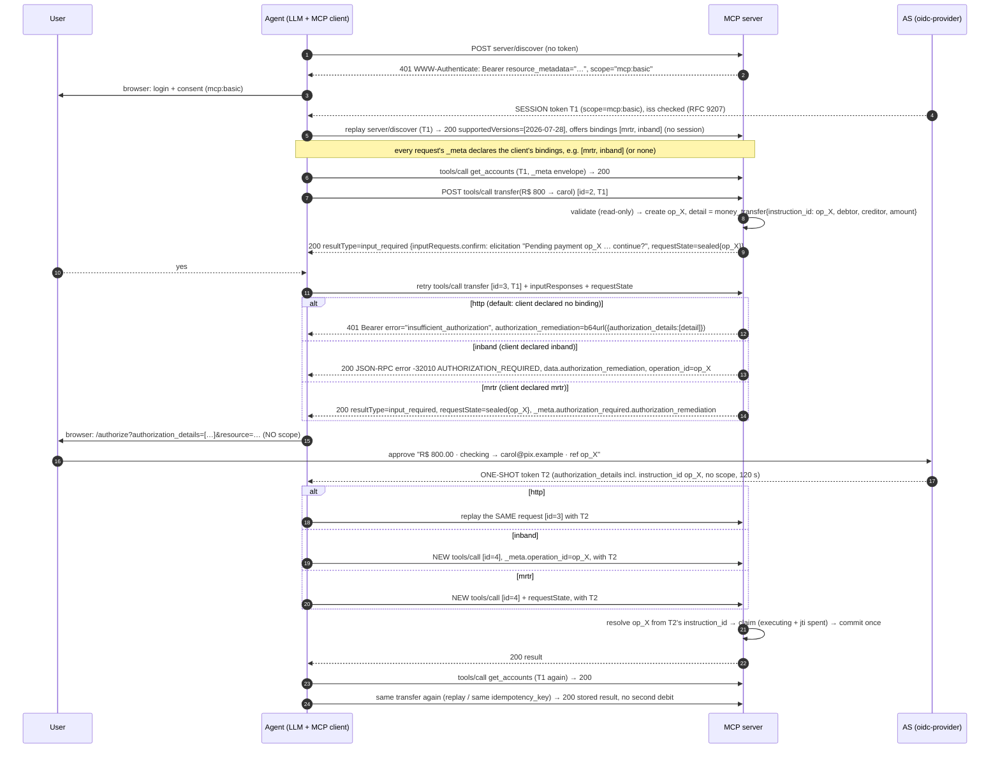

# MCP step-up lab: per-operation authorization with RAR remediation

> Versão em português (Brasil): [README.pt-BR.md](README.pt-BR.md)

A docker compose workspace to validate this proposal. **An MCP tool finds out _while running_ that the operation needs its own authorization, and answers with `401` + `WWW-Authenticate: Bearer error="insufficient_authorization", authorization_remediation=…`, as defined in [draft-ietf-oauth-rar-metadata-remediation](https://datatracker.ietf.org/doc/draft-ietf-oauth-rar-metadata-remediation/). The client holds the in-flight request, obtains a one-shot token carrying exactly the remediation's RFC 9396 `authorization_details`, and replays the same request.** The tool doesn't advertise the requirement up front, and elicitation is never the authorization mechanism.

Three interchangeable **bindings** carry that "authorization required" outcome: `http` (the 401 above), `inband` (JSON-RPC error `-32010`) and **`mrtr`**: a successful MCP 2026-07-28 Multi Round-Trip result, `resultType: "input_required"`, with the remediation in `_meta`. **The client chooses, per request**: it lists the in-band forms it handles in `capabilities.extensions["lab.stepup/rar-remediation"].bindings`, and the server answers with the first one it offers; a client that lists nothing gets the interoperable 401. See [Binding negotiation](#binding-negotiation) and [Tool semantics](#tool-semantics-what-the-lab-does-about-them).

* **Every transfer needs a `money_transfer` grant** whose `authorization_details` pin the debtor account, the creditor (Pix key) and the amount.
* **One-shot tokens.** The operation token carries **no scope** (no previous permission is re-requested), lives 2 minutes, and is burned by the MCP server (by `jti`) when the operation commits. The agent uses it for that single replay and discards it.
* **The session token is kept.** The `mcp:basic` token from login keeps serving balances and every other call. It is never replaced.
* **Atomic challenge.** A 401 means nothing was executed, and a commit guard enforces that.
* **Pending operations.** The replay resumes from a checkpoint, and a duplicate replay returns the stored result.
* **Pre-authorization confirmation.** The user sees what is pending and confirms before the browser redirect (an MRTR `input_required` round, not authorization).
* **MCP 2026-07-28.** Stateless Streamable HTTP (no `initialize`, no `Mcp-Session-Id`), `server/discover`, per-request `_meta` envelope, Multi Round-Trip Requests. Built on the TypeScript SDK v2 (`@modelcontextprotocol/server` / `client` 2.3).

| Component | Path | Role |
|---|---|---|
| **IdP / AS** | `idp/` | [node-oidc-provider](https://github.com/panva/node-oidc-provider) 9.12 with RAR, the `money_transfer` type, a consent page that renders the payment, and the `authorization_details_types_metadata_endpoint` |
| **MCP server** | `mcp-server/` | Stateless Streamable HTTP + stdio resource server (TS SDK v2, MCP 2026-07-28), toy Pix bank, RFC 9728 metadata, pending-operation store, RAR remediation |
| **Agent** | `agent/` | LLM tool-use loop (Claude, or a local model through an OpenAI-compatible API) over an MCP 2026-07-28 client that answers MRTR elicitation rounds and handles Bearer challenges (session and one-shot) |



The three options differ only in how "authorization required" is signalled and how the client retries; the authorization itself (one-shot token for exactly `op_X`) and the execution are the same. The client picks the option per request ([Binding negotiation](#binding-negotiation)).

`docs/components.svg` (`.png`) shows the components and their responsibilities. The detailed PlantUML diagram, `docs/stepup.puml` (rendered `.svg` / `.png`), has the whole flow with the three options side by side, stdio, operation binding, idempotency and the guard.

---

## Step 0: prerequisites

* Docker Desktop (Compose v2.24+)
* An Anthropic API key **or** a local model (see [Running with a local LLM](#running-with-a-local-llm)); the curl probe needs neither
* Ports 8080, 3000 and 8765 free on the host

```bash
cp .env.example .env     # put your ANTHROPIC_API_KEY in it
```

## Step 1: the AS (`idp/src`)

| File | What it does |
|---|---|
| `money-transfer.js` | The `money_transfer` type: JSON Schema (served by the metadata endpoint), a validator and a display helper. Shape: `{type, instruction_id, debtor_account:{account_id}, creditor_account:{pix_key}, instructed_amount:{currency:"BRL", amount:"800.00"}}`. |
| `index.js` | oidc-provider config. `resourceIndicators` issues **JWT** access tokens with `aud = http://mcp-server:3000/mcp`: 600 s for the session grant, 120 s for an operation grant. `richAuthorizationRequests` validates the type, and the code and token carry **only the current request's** `authorization_details`, so nothing accumulates from earlier grants. Discovery adds `authorization_details_types_metadata_endpoint` → `GET /authorization-details-types`. Custom login and consent pages render the payment (amount, debtor, creditor). A lab-only password grant serves the headless probe. |

* **Clients:** `mcp-agent` (public, auth code + PKCE, `authorization_details_types: ["money_transfer"]`) and `mcp-probe` (lab-only password grant).
* **User:** `alice` / `alice`.
* **Hostname split:** the issuer is `http://localhost:8080` for the browser. Containers reach `http://idp:8080`, and the AS pins every URL it emits to the issuer. The agent rewrites back-channel calls with `BACKCHANNEL_REWRITE`.

## Step 2: the MCP server (`mcp-server/src`)

| File | What it does |
|---|---|
| `auth.ts` | Validates JWTs (iss, aud, signature) on every request. A token is either a **session token** (`mcp:basic`) or a **one-shot token** (only `authorization_details`). It also builds the remediation challenge: `401`, `error="insufficient_authorization"`, `error_description`, and `authorization_remediation=<base64url JSON>` with `authorization_details`. There's **no `authorization_reference`**, because the draft says to omit it for single-use tokens. `resource_metadata` is added so the client can find the AS. |
| `stepup.ts` | Per-request context (AsyncLocalStorage) holding the authenticated principal and a challenge slot. `requireAuthorizationDetails(op, detail(s))` passes only if the token carries equal details and its `jti` hasn't been spent; it then claims the operation (`executing`) and spends the `jti` in one step. Otherwise it records a challenge and aborts the tool. `commit()` wraps side effects; the **guard** refuses to challenge after a commit. |
| `operations.ts` | Pending-operation store: checkpoint, status, stored result, TTL. Looked up by the token's `instruction_id`, the MRTR `requestState`, the `_meta` operation id (in-band retry) or `idempotency_key`. There's no `(session, request id)` key: 2026-07-28 has no sessions, and every retry is a new request id. |
| `request-state.ts` | The MRTR `requestState` codec (SDK `createRequestStateCodec`): HMAC-sealed `{op}`, 10 min expiry, **bound to the user's `sub`** (the spec's MUST for state that influences authorization). The server verifies it before any handler runs. |
| `tools.ts` | `transfer`: resolves the operation (see above). On first run it validates (read-only) and creates `op_X`. If the client declared elicitation, it returns **`input_required`** with an embedded confirmation and `requestState`; the client retries with the answer. Then it requires the `money_transfer` details for exactly this operation (`authorizationStep()`: a missing grant is answered in the **negotiated** form: an `input_required` result with a sealed `requestState` for `mrtr`, otherwise the transport challenge, 401 or `-32010`). When authorized it re-validates, commits and spends the token. `naive_batch_transfer` (demo): with a new payee it registers the payee first (a commit), so the guard returns a partial result. With known payees it challenges once with **N `authorization_details`**, so one consent covers the batch. |
| `challenge.ts` | The three bindings. The **transport-independent error** form of the challenge: JSON-RPC error **`AUTHORIZATION_REQUIRED` (-32010)** with `data = {error, error_description, authorization_remediation, resource_metadata, operation_id}`. -32010 sits in the implementation-defined range; 2026-07-28 reserves -32020…-32099 for the spec. `inbandHttpResponse()` rewrites an HTTP JSON response; `StdioAuthTransport` wraps the stdio transport. The **MRTR** form (`authorizationRequiredData()`) puts the same data in a result's `_meta["lab.stepup/authorization_required"]`; `chooseBinding()` does the [negotiation](#binding-negotiation): server policy (`CHALLENGE_BINDING`) and `OFFERED_BINDINGS` (advertised on `server/discover`) against the client's `capabilities.extensions["lab.stepup/rar-remediation"].bindings`. It also defines the lab `_meta` keys: `lab.stepup/operation_id` (resume a pending operation) and `lab.stepup/access_token` (one-shot token, stdio only). |
| `index.ts` | `createMcpHandler` (per-request server, JSON response mode, 2025-era traffic rejected). Authenticates every POST, then rewrites a recorded challenge into the 401 (the negotiated form `http`, the default). The 401/403 body is **RFC 9457 problem details, not a JSON-RPC response**: a transport challenge leaves the request unanswered, so replaying the same request is legitimate. When the negotiated form is `inband`, the JSON-RPC result becomes the `-32010` error instead. A one-shot token is accepted only for a payment `tools/call`; anything else gets `403 insufficient_scope`. |
| `stdio.ts` | The same server over **stdio** (`serveStdio`, which negotiates the era with `server/discover`). The session token comes from `MCP_ACCESS_TOKEN`, challenges are always in-band, and the one-shot token arrives in `_meta`. |
| `stdio-probe.ts` | A headless stdio walkthrough: `-32010` → one-shot token → retry with `_meta` → stored result on duplicate → one-shot token refused for a non-payment tool. |

## Step 3: the agent (`agent/src`)

| File | What it does |
|---|---|
| `stepup-fetch.ts` | The client half. **401 / 403 insufficient_scope** → (re)obtain the **session** token, replay, keep using it. **401 insufficient_authorization** → decode `authorization_remediation`, obtain a **one-shot** token, replay **this one request** with it, discard it. If the replay fails again, that's non-remediable and the client stops (draft §7.1 step 4, §7.3.3). If the user **declines** (or remediation is impossible), the `tools/call` is answered locally with a `CallToolResult` with **`isError: true`** ("the user declined… do not retry"), not a transport error, so the model sees a tool outcome and doesn't loop. |
| `call-tool.ts` | `callToolWithAuthorization()`, the tool-call driver, in the SDK's **manual MRTR mode** (`allowInputRequired`). On `input_required` with `inputRequests` it answers them with the elicitation handler and retries with `inputResponses` + `requestState`. On `input_required` with the **`lab.stepup/authorization_required` hint** it runs the one-shot authorization and retries with the echoed `requestState`. On JSON-RPC error **-32010** it runs the same authorization and **retries as a new `tools/call`** with `_meta["lab.stepup/operation_id"]`. The one-shot token is attached to exactly that retry (`oauth.armOneShot`, matched by `requestState` or operation id). One fresh authorization per call; a denial becomes an `isError` result. |
| `oauth.ts` | Discovery (PRM → AS metadata, issuer check, `authorization_details_types_supported` check). Validates `iss` in the authorization response (RFC 9207; a MUST for MCP 2026-07-28 clients). The code flow + PKCE + `resource` is shared by the session grant (`scope=…`) and the operation grant (`authorization_details=…`, **no scope**). The session token is never overwritten by an operation token. |
| `elicitation.ts` | Form elicitation in the terminal (`Y/n/c`). In 2026-07-28 the server embeds it in an `input_required` result; the SDK's multi-round-trip driver calls this handler and retries the call with the answer. |
| `index.ts` | Connects MCP pinned to 2026-07-28 (`server/discover`, no `initialize`), wires `callToolWithAuthorization` into the LLM loop. Declares the elicitation capability and the `lab.stepup/rar-remediation` extension with `bindings` from `AGENT_BINDINGS` (default `mrtr,inband`; empty = declare nothing, get the 401), with a 5 min timeout for held requests. |
| `llm.ts` | LLM drivers: `anthropic` (Claude) and `openai` (any OpenAI-compatible server, e.g. a local Ollama model). See [Running with a local LLM](#running-with-a-local-llm). |

## Step 4: run it

```bash
docker compose down              # if the previous (Keycloak) version is still running
docker compose up -d --build
docker compose ps                # idp and mcp-server "healthy"

bash scripts/probe.sh            # raw-HTTP proof, no LLM
docker compose run --build --rm --service-ports agent
```

**Variants:**

```bash
# The server negotiates by default (CHALLENGE_BINDING=negotiate); the agent picks the form:
docker compose run --build --rm --service-ports agent                          # mrtr (its 1st choice)
AGENT_BINDINGS=inband docker compose run --build --rm --service-ports agent    # JSON-RPC error -32010
AGENT_BINDINGS= docker compose run --build --rm --service-ports agent          # declares nothing: 401
bash scripts/probe-bindings.sh   # raw-HTTP proof of the negotiation and of the MRTR binding

# Or fix the form on the server side, for every client:
CHALLENGE_BINDING=http docker compose up -d mcp-server     # always 401 (also: inband, mrtr)

# The same server over stdio (in-band is the only option there):
docker compose run --rm mcp-server node src/stdio-probe.ts
```

`probe.sh` shows:

1. 401 with no token.
2. `server/discover` with the session token (it replaces `initialize`; no session is created). Every request carries the 2026-07-28 `_meta` envelope and the `MCP-Protocol-Version` / `Mcp-Method` / `Mcp-Name` headers.
3. With the session token, a transfer gets **401 `insufficient_authorization`**. The remediation carries `instruction_id` = the pending operation id. The script gets a one-shot token with exactly those details. (The probe declares no elicitation capability, so there's no confirmation round.)
4. The one-shot token used for `get_accounts` gets **403**.
5. A second, identical transfer (a new request) gets its **own** `instruction_id`.
6. The token approved for the first operation is **refused** on a request that names the second operation, and on a transfer with a different amount. Nothing is executed.
7. The same token replaying the original request returns **200**. Replaying again returns the stored result, with no double debit.
8. Two new requests with the same `idempotency_key` share one operation (same `instruction_id`). A third returns the stored result without new authorization, and the same key with a different amount is refused.
9. The naive batch triggers the guard.
10. Balances still work with the session token: exactly the two approved transfers were debited.

`probe-bindings.sh` shows: the offered forms advertised on `server/discover`; the same transfer from four clients: declaring nothing gets the **401**, `[inband]` gets **`-32010`**, `[mrtr, inband]` gets **`input_required`** (its first choice), an unknown form gets the 401; then the MRTR flow end to end: **200 `input_required`** with `requestState` and the remediation in `_meta`; a retry without a token gets the same step again; the retry with `requestState` + the one-shot token executes once, and again returns the stored result; a tampered `requestState` is rejected with `-32602` before the tool runs; a `requestState` on a call with other arguments is refused.

In the agent REPL:

1. Log in (`alice` / `alice`) and **Allow** "Read your accounts and balances".
2. `what are my balances?`: uses the session token.
3. `send R$ 800 to carol@pix.example from checking`: answer **y** to the confirmation (an MRTR round: the call returns `input_required`, the client retries with your answer). The browser shows **"Approve this payment: R$ 800.00, checking → carol@pix.example"**. Approve it and the transfer completes. The agent log shows `one-shot token issued, scope=""`.
4. `what are my balances now?`: no login and no consent. The session token is reused.
5. `send R$ 50 to bob@pix.example from checking`: even a small payment to a known payee needs its own approval.
6. Try **n** at the confirmation (nothing happens) or **Deny** in the browser (the call fails, the balance is unchanged).

Logs: `docker compose logs -f idp mcp-server` shows `[consent]`, `[token]` (scope and authorization_details per token), `[op]`, `[auth] one-shot token … consumed` and `[guard]`.

## What this lab surfaced (input for the proposal)

1. **RAR remediation fits MCP well.** The 401 carries everything the client needs to build the authorization request (`authorization_details`), and RFC 9728 points it at the AS. No out-of-band knowledge of the tool's requirements is needed. The draft's design choice to use **401** (changed from 403) works here, because the client tells the cases apart by `error`.
2. **Two-token client model.** The client must keep a long-lived **session token** and treat remediation tokens as **request-scoped**. An SDK that stores "the" token (like today's `authProvider`) would overwrite the session token with a token that can't call anything else. That should be called out in the MCP authorization spec.
3. **Single use needs RS state.** OAuth has no "one-shot access token". The lab gets it from short TTL + no refresh token + `jti` consumption at the RS + exact details matching. The draft's rule of omitting `authorization_reference` for single-use tokens is what stops clients from caching them.
4. **Atomic challenge rule.** A server MUST NOT send `insufficient_authorization` after committing side effects for that request. That's what makes the replay safe. Non-atomic work reports partial progress in-band (guard demo).
5. **Replay identity and operation binding.** MCP 2026-07-28 has no sessions, and every MRTR retry has a new request id, so neither identifies an operation. The lab puts the server's operation id in the details (`instruction_id`), resolves the operation from the token, and claims it atomically. See [Operation binding and idempotency](#operation-binding-and-idempotency). Open gap: the AS can't verify that a client didn't alter `instruction_id` (the server rejects a mismatch). A remediation signed by the server would close that.
6. **Consent shows the real operation.** Because the AS receives `authorization_details`, its consent page renders the amount, debtor and creditor. The earlier scope-based version couldn't do that.
7. **Batch.** One remediation can carry N `authorization_details`, so one consent and one token cover N transfers.
8. **Elicitation versus HTTP challenges.** In 2026-07-28 the confirmation is an MRTR round (`input_required` + `requestState`), so it fits JSON response mode naturally. Elicitation remains UX only; authorization comes from the AS. The 401 is still a transport-level error: MRTR has no input type for "get a token with these `authorization_details`" (that would be an extension).
9. **Timeouts.** A held request waits on a human, so the SDK's 60 s default is too short.
10. **"Authorization required" doesn't have to be an error.** With MRTR (negotiated `mrtr`) it is a successful `input_required` result, so the tool call stays one logical operation across rounds and the operation id travels in the sealed `requestState`. It needs a lab extension today, so the client discloses which forms it handles and the server falls back to the 401 for everyone else ([Binding negotiation](#binding-negotiation)).
11. **2025-era clients are rejected.** The SDK can serve 2025 clients statelessly, but that leg answers over SSE, which commits a `200` before the tool runs and could not carry the mid-tool 401. The server uses `legacy: "reject"` (`-32022` UnsupportedProtocolVersion).

## Running with a local LLM

The model only decides which tool to call. Login, step-up, one-shot tokens and replays all live in the MCP client, so a local model exercises exactly the same authorization flow. `agent/src/llm.ts` has two drivers:

* `LLM_PROVIDER=anthropic` (default): Claude via `ANTHROPIC_API_KEY` / `ANTHROPIC_MODEL`.
* `LLM_PROVIDER=openai`: any OpenAI-compatible `/v1/chat/completions` server with tool calling, such as Ollama, LM Studio, llama.cpp server or vLLM.

On a Mac, run the model **natively, not in Docker**. Docker Desktop can't use the Apple GPU, so a model inside a container would be CPU-only. The agent container reaches the host through `host.docker.internal`.

```bash
# 1. on the Mac (Ollama app or `brew install ollama`)
ollama pull llama3.2:1b            # a tool-calling model; ~5 GB, fine on 16 GB RAM
ollama serve                    # skip if the Ollama menu-bar app is running

# 2. in .env
LLM_PROVIDER=openai
LLM_MODEL=llama3.2:1b
# OPENAI_BASE_URL=http://host.docker.internal:1234/v1   # for LM Studio instead of Ollama

# 3. run as usual (no Anthropic key needed)
docker compose run --build --rm --service-ports agent
```

The startup log shows `LLM: openai-compatible / llama3.2:1b @ http://host.docker.internal:11434/v1`.

What the driver does to help small models:

* It turns string arguments into numbers where the tool schema says number, so `"R$ 800,00"` becomes `800`. The server's own validation still rejects anything wrong.
* It reports invalid JSON arguments back to the model as tool errors.
* It strips `<think>…</think>` from the replies of reasoning models.
* It caps model round-trips per message (`LLM_MAX_STEPS`, default 8).
* It drops `$schema` from tool schemas.

Expect weaker tool choice and slower replies than with Claude. Small models may also ignore the "don't retry after a refusal" instruction. That's harmless, because every transfer still needs its own approval, but you may be asked twice.

## Operation binding and idempotency

Matching a token's `authorization_details` by value isn't enough: a token for "R$ 800 from checking to carol" would fit any operation with those values. The lab therefore binds every grant to one operation instance:

* **`instruction_id` in the details.** The `money_transfer` type requires `instruction_id` (pattern `op_…`; compare ISO 20022 `InstrId` or Open Finance Brasil `endToEndId`). The server fills it with the pending operation's id, the AS validates it and shows it on the consent screen as "Payment reference", and the token carries it. Batch items use `op_<id>-1`, `op_<id>-2`, and so on.
* **The operation is resolved from the token.** When a payment token arrives, the server loads the operation named by its `instruction_id` and checks that the user, the tool and the argument hash match the request. It refuses if the request already belongs to another operation (found by `requestState`, `_meta` or idempotency key). A token approved for op_A can't execute op_B, even when both carry identical amounts and accounts.
* **Claiming is one atomic state change.** `awaiting_authorization → executing` happens in one synchronous step, together with recording the token's `jti` against that operation, before any side effect. A token is therefore spent on exactly one operation, and an operation runs once, even if the execution later includes `await`s.
* **Completed means idempotent.** Any later call for a completed operation (a replay, the spent token again, the same `idempotency_key`) returns the stored result. Nothing is executed again and no new authorization is requested.
* **`idempotency_key` (optional tool argument).** Two new requests with the same key share one operation, and therefore the same `instruction_id` and approval. Reusing a key with different arguments is refused.

* **`requestState` carries the operation across MRTR rounds.** It's HMAC-sealed, expires and is bound to the user, and the server verifies it before the handler runs. A confirmation answer is only accepted when the operation was found through it.

`probe.sh` steps 5–8 demonstrate each case: two identical transfers get different `instruction_id`s, a token is refused on another operation or other parameters, and a shared idempotency key returns the stored result or rejects a different amount.

## Tool semantics: what the lab does about them

The challenge is modeled as one abstract outcome: **"authorization required for these `authorization_details`; nothing was executed"**. Each transport carries it in its own way:

| | HTTP binding (`401`) | In-band binding (`-32010`) | MRTR binding (`input_required`) |
|---|---|---|---|
| Was the JSON-RPC request answered? | **No.** The body is problem details, not a JSON-RPC response | **Yes**, with a JSON-RPC error | **Yes**, with a successful result (`resultType: "input_required"`) |
| Is it an error? | Transport error | Protocol error | **No.** A step the client performs |
| Where the remediation travels | `WWW-Authenticate` (`authorization_remediation`, base64url) | `error.data` | `result._meta["lab.stepup/authorization_required"]` |
| How the client continues | Replays the **same** request (same id, same body, including `requestState`) | Sends a **new** `tools/call` with `_meta["lab.stepup/operation_id"]` | Retries the call (new id) echoing **`requestState`** |
| How the server resumes | Operation named by the token's `instruction_id` (and `requestState`) | Operation named by `_meta` and the token's `instruction_id` | Operation named by `requestState` and the token's `instruction_id` |
| Where the one-shot token goes | `Authorization` header | `Authorization` header (HTTP) or `_meta["lab.stepup/access_token"]` (stdio) | Same as in-band |
| Transports | Streamable HTTP only | Any (HTTP, stdio) | Any (HTTP, stdio) |
| Who gets it | Any client (the default) | Clients that declare `inband` | Clients that declare `mrtr` |

In all three a **user refusal is a tool result** (`isError: true`), and the guard keeps the "nothing was executed" promise. The `-32010` code, the `_meta` keys and the extension are lab-defined (2026-07-28 reserves -32020…-32099 for the spec, so a lab code lives in the implementation range). Standardizing them is part of the proposal.

The pre-authorization confirmation is the 2026-07-28 **non-error** step (`resultType: "input_required"` with an embedded elicitation), in every binding. With `mrtr` the authorization step joins it: one call becomes up to three rounds (confirm → authorize → execute), all of them successful results.

### Binding negotiation

The in-band forms are only understood by clients that know this lab's conventions, so the **client discloses which ones it handles**, and the server never sends a form the client didn't ask for:

```jsonc
// every request's _meta (MCP 2026-07-28 sends client capabilities per request)
"io.modelcontextprotocol/clientCapabilities": {
  "elicitation": { "form": {} },
  "extensions": { "lab.stepup/rar-remediation": { "bindings": ["mrtr", "inband"] } }   // preference order
}
// server/discover result: what this server offers
"capabilities": { "extensions": { "lab.stepup/rar-remediation": { "bindings": ["mrtr", "inband"] } } }
```

The server answers with the client's first preference that it offers. A client that declares nothing, or nothing in common, gets the **401** (on stdio, which has no HTTP status, `-32010`). Declaring the extension without `bindings` means `["mrtr"]`. Because the capabilities travel with every request, the decision is per request, not per connection; the server log shows it (`authorization required -> binding mrtr (client prefers [...], server offers [...])`).

`CHALLENGE_BINDING` is the **server policy**: `negotiate` (default; offers `mrtr` and `inband`), `mrtr` (offers only `mrtr`), `http` (always 401) or `inband` (always `-32010`, without negotiation). In the agent, `AGENT_BINDINGS` sets the declared list.

Why it needs negotiating at all. MRTR's core input types are elicitation, sampling and roots; there is none for "obtain an access token with these `authorization_details`". So the MRTR authorization step is a `requestState`-only `input_required` with a hint in `_meta`. The spec lets a client retry such a result immediately, so a client that doesn't understand the hint would loop until its round cap; one that doesn't know `-32010` would see an unexplained protocol error. Declaring the form is the client saying "I'll run the OAuth flow for this". A standard version would be a SEP-2643-style authorization remediation hint, or a new input request type.

## Troubleshooting

* **`invalid_authorization_details` from the AS.** The details don't match the `money_transfer` schema. See `GET http://localhost:8080/authorization-details-types`.
* **The browser says "Unknown or already used state".** You opened an old authorization URL. Use the latest one the agent printed.
* **`Unsupported protocol version` (`-32022`) or `Version negotiation failed`.** Client and server must both speak 2026-07-28. The server rejects 2025-era traffic (`initialize`); rebuild a stale agent image (`docker compose run --build …`).
* **The agent gets a 401 although it should negotiate.** Check the server log line `authorization required -> binding …`: the server policy (`CHALLENGE_BINDING`) may not offer what `AGENT_BINDINGS` declares, or the agent image is stale (the banner must list `in-band forms declared`).
* **`Invalid or expired requestState`.** An MRTR retry came back more than 10 minutes later, under another user's token, or after the server restarted (the HMAC key is per process unless `REQUEST_STATE_KEY` is set). Start the transfer again.
* **`invalid_token` after restarting `idp`.** The AS generates a new signing key on start. Restart the agent so it logs in again.
* **The agent asks for `scope=mcp:basic` instead of the `authorization_details` on a transfer.** You're running a stale agent image. The `agent` service sits behind a profile, so `docker compose up --build` does **not** rebuild it, and `docker compose run` reuses the old image. Always start it with `docker compose run --build …` (or run `docker compose --profile agent build`). The startup banner must say `agent (MCP 2026-07-28)`.
* **`EACCES: permission denied, open '/app/src/index.ts'`.** The source files are owner-only (`600`). The Dockerfiles use `COPY --chown=node:node`; rebuild the images with `docker compose --profile agent build`.
* **Reset everything.** `docker compose down && docker compose up -d`. All state is in memory.
