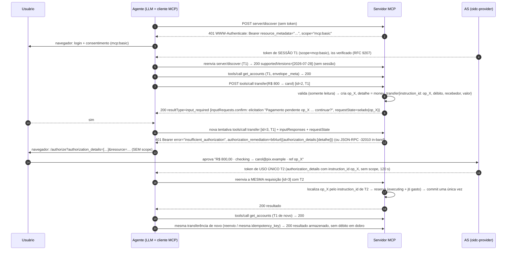

# MCP step-up lab: autorização por operação com remediação RAR

> English version: [README.md](README.md)

Um ambiente com docker compose para validar esta proposta. **Uma ferramenta (tool) MCP descobre _durante a execução_ que a operação precisa de autorização própria e responde com `401` + `WWW-Authenticate: Bearer error="insufficient_authorization", authorization_remediation=…`, conforme definido no [draft-ietf-oauth-rar-metadata-remediation](https://datatracker.ietf.org/doc/draft-ietf-oauth-rar-metadata-remediation/). O cliente retém a requisição em andamento, obtém um token de uso único contendo exatamente os `authorization_details` (RFC 9396) indicados na remediação e reenvia a mesma requisição.** A ferramenta não anuncia o requisito antecipadamente, e a elicitation nunca é o mecanismo de autorização.

* **Toda transferência exige um grant `money_transfer`**, cujos `authorization_details` fixam a conta de débito (debtor), o recebedor (chave Pix, creditor) e o valor.
* **Tokens de uso único (one-shot).** O token da operação **não tem scope** (nenhuma permissão anterior é solicitada de novo), vale 2 minutos e é invalidado pelo servidor MCP (pelo `jti`) quando a operação é efetivada. O agente o usa nesse único reenvio e o descarta.
* **O token de sessão é preservado.** O token `mcp:basic` obtido no login continua atendendo à consulta de saldos e a todas as outras chamadas. Ele nunca é substituído.
* **Desafio atômico.** Um 401 significa que nada foi executado, e um guard de commit garante isso.
* **Operações pendentes.** O reenvio retoma a operação a partir de um checkpoint, e um reenvio duplicado devolve o resultado armazenado.
* **Confirmação antes da autorização.** O usuário vê o que está pendente e confirma antes do redirecionamento para o navegador (uma rodada MRTR `input_required`, não é autorização).
* **MCP 2026-07-28.** Streamable HTTP sem estado (sem `initialize`, sem `Mcp-Session-Id`), `server/discover`, envelope `_meta` em cada requisição, Multi Round-Trip Requests. Construído sobre o SDK TypeScript v2 (`@modelcontextprotocol/server` / `client` 2.3).

| Componente | Caminho | Papel |
|---|---|---|
| **IdP / AS** | `idp/` | [node-oidc-provider](https://github.com/panva/node-oidc-provider) 9.12 com RAR, o tipo `money_transfer`, uma tela de consentimento que exibe o pagamento e o `authorization_details_types_metadata_endpoint` |
| **Servidor MCP** | `mcp-server/` | Resource server Streamable HTTP sem estado + stdio (TS SDK v2, MCP 2026-07-28), banco Pix de brinquedo, metadados RFC 9728, armazenamento de operações pendentes, remediação RAR |
| **Agente** | `agent/` | Loop de tool use com um LLM (Claude, ou um modelo local via API compatível com OpenAI) sobre um cliente MCP 2026-07-28 que responde às rodadas MRTR de elicitation e trata desafios Bearer (sessão e uso único) |



Diagramas PlantUML detalhados (vínculo com a operação, idempotência, guard), um por binding:

* `docs/stepup-http.puml`: **binding HTTP**, 401 `insufficient_authorization` e reenvio da mesma requisição (renderizado em `.svg` / `.png`).
* `docs/stepup-stream.puml`: **binding de stream / in-band**, erro JSON-RPC `-32010` e nova tentativa como requisição nova que referencia a operação, via stdio ou Streamable HTTP com `CHALLENGE_BINDING=inband` (renderizado em `.svg` / `.png`).

---

## Passo 0: pré-requisitos

* Docker Desktop (Compose v2.24+)
* Uma chave de API da Anthropic **ou** um modelo local (veja [Rodando com um LLM local](#rodando-com-um-llm-local)); o probe com curl não precisa de nenhum dos dois
* Portas 8080, 3000 e 8765 livres no host

```bash
cp .env.example .env     # coloque sua ANTHROPIC_API_KEY nele
```

## Passo 1: o AS (`idp/src`)

| Arquivo | O que faz |
|---|---|
| `money-transfer.js` | O tipo `money_transfer`: JSON Schema (servido pelo endpoint de metadados), um validador e um helper de exibição. Formato: `{type, instruction_id, debtor_account:{account_id}, creditor_account:{pix_key}, instructed_amount:{currency:"BRL", amount:"800.00"}}`. |
| `index.js` | Configuração do oidc-provider. `resourceIndicators` emite access tokens **JWT** com `aud = http://mcp-server:3000/mcp`: 600 s para o grant de sessão e 120 s para um grant de operação. `richAuthorizationRequests` valida o tipo, e o code e o token carregam **apenas os `authorization_details` da requisição atual**, então nada se acumula de grants anteriores. O discovery inclui `authorization_details_types_metadata_endpoint` → `GET /authorization-details-types`. Telas próprias de login e consentimento exibem o pagamento (valor, conta de débito, recebedor). Um password grant exclusivo do laboratório atende o probe sem navegador. |

* **Clientes:** `mcp-agent` (público, authorization code + PKCE, `authorization_details_types: ["money_transfer"]`) e `mcp-probe` (password grant, só para o laboratório).
* **Usuário:** `alice` / `alice`.
* **Separação de hostnames:** o issuer é `http://localhost:8080` para o navegador. Os containers acessam `http://idp:8080`, e o AS fixa no issuer todas as URLs que emite. O agente reescreve as chamadas de back-channel com `BACKCHANNEL_REWRITE`.

## Passo 2: o servidor MCP (`mcp-server/src`)

| Arquivo | O que faz |
|---|---|
| `auth.ts` | Valida os JWTs (iss, aud, assinatura) em toda requisição. Um token é ou um **token de sessão** (`mcp:basic`) ou um **token de uso único** (somente `authorization_details`). Também monta o desafio de remediação: `401`, `error="insufficient_authorization"`, `error_description` e `authorization_remediation=<JSON em base64url>` com os `authorization_details`. **Não há `authorization_reference`**, porque o draft manda omiti-lo para tokens de uso único. O `resource_metadata` é incluído para que o cliente encontre o AS. |
| `stepup.ts` | Contexto por requisição (AsyncLocalStorage) com o principal autenticado e um espaço para o desafio. `requireAuthorizationDetails(op, detalhe(s))` só passa se o token tiver detalhes idênticos e seu `jti` ainda não tiver sido gasto; então reserva a operação (`executing`) e gasta o `jti` num único passo. Caso contrário, registra um desafio e interrompe a ferramenta. `commit()` envolve os efeitos colaterais; o **guard** se recusa a desafiar depois de um commit. |
| `operations.ts` | Armazenamento de operações pendentes: checkpoint, status, resultado armazenado, TTL. Localizadas pelo `instruction_id` do token, pelo `requestState` do MRTR, pelo id de operação em `_meta` (nova tentativa in-band) ou pela `idempotency_key`. Não há chave `(sessão, id da requisição)`: a 2026-07-28 não tem sessões, e cada nova tentativa tem um id novo. |
| `request-state.ts` | O codec do `requestState` do MRTR (`createRequestStateCodec` do SDK): `{op}` selado com HMAC, expira em 10 min e é **vinculado ao `sub` do usuário** (o MUST da especificação para estado que influencia autorização). O servidor o verifica antes de qualquer handler rodar. |
| `tools.ts` | `transfer`: localiza a operação (veja acima). Na primeira execução, valida (somente leitura) e cria `op_X`. Se o cliente declarou elicitation, devolve **`input_required`** com a confirmação embutida e o `requestState`; o cliente tenta de novo com a resposta. Então exige os detalhes `money_transfer` exatamente desta operação. Autorizada, revalida, efetiva e gasta o token. `naive_batch_transfer` (demo): com um recebedor novo, cadastra o recebedor primeiro (um commit), então o guard devolve um resultado parcial. Com recebedores conhecidos, desafia uma única vez com **N `authorization_details`**, de modo que um consentimento cobre o lote. |
| `challenge.ts` | A forma **independente de transporte** do desafio: erro JSON-RPC **`AUTHORIZATION_REQUIRED` (-32010)** com `data = {error, error_description, authorization_remediation, resource_metadata, operation_id}`. O -32010 fica na faixa definida pela implementação; a 2026-07-28 reserva -32020…-32099 para a especificação. `inbandHttpResponse()` reescreve uma resposta HTTP JSON; `StdioAuthTransport` envolve o transporte stdio. Também define as chaves `_meta` do laboratório: `lab.stepup/operation_id` (retomar uma operação pendente) e `lab.stepup/access_token` (token de uso único, só em stdio). |
| `index.ts` | `createMcpHandler` (servidor por requisição, modo de resposta JSON, tráfego da era 2025 rejeitado). Autentica todo POST e, com `CHALLENGE_BINDING=http` (padrão), converte um desafio registrado no 401. O corpo do 401/403 é **RFC 9457 (problem details), não uma resposta JSON-RPC**: um desafio de transporte deixa a requisição sem resposta, então reenviar a mesma requisição é legítimo. Com `CHALLENGE_BINDING=inband`, o resultado JSON-RPC vira o erro `-32010`. Um token de uso único só é aceito em um `tools/call` de pagamento; qualquer outra coisa recebe `403 insufficient_scope`. |
| `stdio.ts` | O mesmo servidor via **stdio** (`serveStdio`, que negocia a era com `server/discover`). O token de sessão vem de `MCP_ACCESS_TOKEN`, os desafios são sempre in-band e o token de uso único chega em `_meta`. |
| `stdio-probe.ts` | Demonstração via stdio sem navegador: `-32010` → token de uso único → nova tentativa com `_meta` → resultado armazenado na duplicata → token de uso único recusado em ferramenta que não é de pagamento. |

## Passo 3: o agente (`agent/src`)

| Arquivo | O que faz |
|---|---|
| `stepup-fetch.ts` | A metade cliente. **401 / 403 insufficient_scope** → (re)obtém o token de **sessão**, reenvia e continua usando-o. **401 insufficient_authorization** → decodifica o `authorization_remediation`, obtém um token de **uso único**, reenvia **apenas esta requisição** com ele e o descarta. Se o reenvio falhar de novo, o caso não é remediável e o cliente para (draft §7.1 passo 4, §7.3.3). Se o usuário **recusar** (ou a remediação for impossível), o `tools/call` é respondido localmente com um `CallToolResult` com **`isError: true`** ("o usuário recusou… não tente de novo"), e não com um erro de transporte, então o modelo vê um resultado de ferramenta e não entra em loop. |
| `inband.ts` | `callToolWithAuthorization()`: ao receber o erro JSON-RPC **-32010**, executa a mesma autorização de uso único e **tenta de novo como um novo `tools/call`** com `_meta["lab.stepup/operation_id"]`. O servidor retoma o checkpoint, sem uma segunda confirmação. O token de uso único é anexado exatamente a essa requisição (`oauth.armOneShot`). Uma recusa também vira um resultado `isError`. |
| `oauth.ts` | Discovery (PRM → metadados do AS, verificação do issuer, verificação de `authorization_details_types_supported`). Valida o `iss` na resposta de autorização (RFC 9207; MUST para clientes MCP 2026-07-28). O fluxo authorization code + PKCE + `resource` é compartilhado pelo grant de sessão (`scope=…`) e pelo grant de operação (`authorization_details=…`, **sem scope**). O token de sessão nunca é sobrescrito por um token de operação. |
| `elicitation.ts` | Elicitation de formulário no terminal (`Y/n/c`). Na 2026-07-28 o servidor a embute num resultado `input_required`; o driver multi-round-trip do SDK chama este handler e repete a chamada com a resposta. |
| `index.ts` | Conecta ao MCP fixado na 2026-07-28 (`server/discover`, sem `initialize`) e liga o `callToolWithAuthorization` ao loop do LLM. Declara a capability de elicitation, com timeout de 5 min para requisições retidas. |
| `llm.ts` | Drivers de LLM: `anthropic` (Claude) e `openai` (qualquer servidor compatível com OpenAI, por exemplo um modelo local no Ollama). Veja [Rodando com um LLM local](#rodando-com-um-llm-local). |

## Passo 4: execute

```bash
docker compose down              # se a versão anterior (Keycloak) ainda estiver rodando
docker compose up -d --build
docker compose ps                # idp e mcp-server "healthy"

bash scripts/probe.sh            # prova via HTTP puro, sem LLM
docker compose run --build --rm --service-ports agent
```

**Variantes:**

```bash
# O mesmo fluxo com o binding in-band via HTTP (erro JSON-RPC -32010 em vez de 401):
CHALLENGE_BINDING=inband docker compose up -d --build mcp-server
docker compose run --build --rm --service-ports agent

# O mesmo servidor via stdio (lá, in-band é a única opção):
docker compose run --rm mcp-server node src/stdio-probe.ts
```

O `probe.sh` mostra:

1. 401 sem token.
2. `server/discover` com o token de sessão (substitui o `initialize`; nenhuma sessão é criada). Toda requisição leva o envelope `_meta` da 2026-07-28 e os headers `MCP-Protocol-Version` / `Mcp-Method` / `Mcp-Name`.
3. Com o token de sessão, uma transferência recebe **401 `insufficient_authorization`**. A remediação traz `instruction_id` = o id da operação pendente. O script obtém um token de uso único com exatamente esses detalhes. (O probe não declara a capability de elicitation, então não há rodada de confirmação.)
4. O token de uso único usado em `get_accounts` recebe **403**.
5. Uma segunda transferência idêntica (requisição nova) recebe seu **próprio** `instruction_id`.
6. O token aprovado para a primeira operação é **recusado** numa requisição que indica a segunda operação e numa transferência com outro valor. Nada é executado.
7. O mesmo token reenviando a requisição original retorna **200**. Reenviar de novo devolve o resultado armazenado, sem débito em dobro.
8. Duas requisições novas com a mesma `idempotency_key` compartilham uma operação (mesmo `instruction_id`). Uma terceira devolve o resultado armazenado sem nova autorização, e a mesma chave com outro valor é recusada.
9. O lote ingênuo aciona o guard.
10. A consulta de saldos continua funcionando com o token de sessão: só as duas transferências aprovadas foram debitadas.

No REPL do agente (pode escrever em português):

1. Faça login (`alice` / `alice`) e clique em **Allow** em "Read your accounts and balances".
2. `quais são meus saldos?`: usa o token de sessão.
3. `envie R$ 800 para carol@pix.example a partir da conta checking`: responda **y** na confirmação (uma rodada MRTR: a chamada devolve `input_required` e o cliente tenta de novo com a sua resposta). O navegador mostra **"Approve this payment: R$ 800.00, checking → carol@pix.example"**. Aprove e a transferência é concluída. O log do agente mostra `one-shot token issued, scope=""`.
4. `e agora, quais são meus saldos?`: sem login e sem consentimento. O token de sessão é reutilizado.
5. `envie R$ 50 para bob@pix.example a partir da conta checking`: até um pagamento pequeno para um recebedor conhecido exige sua própria aprovação.
6. Teste **n** na confirmação (nada acontece) ou **Deny** no navegador (a chamada falha e o saldo não muda).

Logs: `docker compose logs -f idp mcp-server` mostra `[consent]`, `[token]` (scope e authorization_details de cada token), `[op]`, `[auth] one-shot token … consumed` e `[guard]`.

## O que o laboratório revelou (insumos para a proposta)

1. **A remediação RAR se encaixa bem no MCP.** O 401 traz tudo de que o cliente precisa para montar a requisição de autorização (`authorization_details`), e a RFC 9728 aponta para o AS. Não é preciso conhecer de antemão os requisitos da ferramenta. A escolha do draft pelo **401** (antes era 403) funciona aqui, porque o cliente distingue os casos pelo `error`.
2. **Modelo de dois tokens no cliente.** O cliente precisa manter um **token de sessão** de longa duração e tratar os tokens de remediação como **restritos à requisição**. Um SDK que guarda "o" token (como o `authProvider` atual) sobrescreveria o token de sessão por um token que não serve para mais nada. Isso deveria ser explicitado na especificação de autorização do MCP.
3. **Uso único exige estado no RS.** O OAuth não tem "access token de uso único". O laboratório chega a isso com TTL curto + ausência de refresh token + consumo do `jti` no RS + comparação exata dos detalhes. A regra do draft de omitir o `authorization_reference` para tokens de uso único é o que impede os clientes de armazená-los em cache.
4. **Regra do desafio atômico.** Um servidor NÃO DEVE (MUST NOT) enviar `insufficient_authorization` depois de efetivar efeitos colaterais daquela requisição. É isso que torna o reenvio seguro. Trabalho não atômico informa o progresso parcial na própria resposta (demo do guard).
5. **Identidade do reenvio e vínculo com a operação.** A MCP 2026-07-28 não tem sessões, e cada nova tentativa MRTR tem um id de requisição novo, então nenhum dos dois identifica uma operação. O laboratório coloca o id da operação do servidor nos detalhes (`instruction_id`), localiza a operação pelo token e a reserva de forma atômica. Veja [Vínculo com a operação e idempotência](#vínculo-com-a-operação-e-idempotência). Lacuna em aberto: o AS não consegue verificar se o cliente alterou o `instruction_id` (o servidor rejeita a divergência). Uma remediação assinada pelo servidor resolveria isso.
6. **O consentimento mostra a operação real.** Como o AS recebe os `authorization_details`, a tela de consentimento exibe valor, conta de débito e recebedor. A versão anterior, baseada em scopes, não conseguia fazer isso.
7. **Lote.** Uma única remediação pode carregar N `authorization_details`, então um consentimento e um token cobrem N transferências.
8. **Elicitation versus desafios HTTP.** Na 2026-07-28 a confirmação é uma rodada MRTR (`input_required` + `requestState`), então se encaixa naturalmente no modo de resposta JSON. A elicitation continua sendo só UX; a autorização vem do AS. O 401 continua sendo um erro de transporte: o MRTR não tem um tipo de input para "obtenha um token com estes `authorization_details`" (isso seria uma extensão).
9. **Timeouts.** Uma requisição retida espera por uma pessoa, então o padrão de 60 s do SDK é curto demais.
10. **Clientes da era 2025 são rejeitados.** O SDK consegue atender clientes 2025 sem estado, mas essa via responde por SSE, que confirma um `200` antes de a ferramenta rodar e não conseguiria levar o 401 no meio da ferramenta. O servidor usa `legacy: "reject"` (`-32022` UnsupportedProtocolVersion).

## Rodando com um LLM local

O modelo só decide qual ferramenta chamar. Login, step-up, tokens de uso único e reenvios ficam todos no cliente MCP, então um modelo local exercita exatamente o mesmo fluxo de autorização. `agent/src/llm.ts` tem dois drivers:

* `LLM_PROVIDER=anthropic` (padrão): Claude via `ANTHROPIC_API_KEY` / `ANTHROPIC_MODEL`.
* `LLM_PROVIDER=openai`: qualquer servidor compatível com OpenAI (`/v1/chat/completions`) com tool calling, como Ollama, LM Studio, llama.cpp server ou vLLM.

No Mac, rode o modelo **nativamente, não no Docker**. O Docker Desktop não usa a GPU da Apple, então um modelo dentro de um container rodaria só na CPU. O container do agente acessa o host por `host.docker.internal`.

```bash
# 1. no Mac (app do Ollama ou `brew install ollama`)
ollama pull llama3.2:1b            # modelo com tool calling; ~5 GB, roda bem com 16 GB de RAM
ollama serve                    # dispensável se o app do Ollama estiver na barra de menus

# 2. no .env
LLM_PROVIDER=openai
LLM_MODEL=llama3.2:1b
# OPENAI_BASE_URL=http://host.docker.internal:1234/v1   # para LM Studio em vez de Ollama

# 3. rode como de costume (sem chave da Anthropic)
docker compose run --build --rm --service-ports agent
```

O log de inicialização mostra `LLM: openai-compatible / llama3.2:1b @ http://host.docker.internal:11434/v1`.

O que o driver faz para ajudar modelos pequenos:

* Converte argumentos em texto para número onde o schema da ferramenta pede número, então `"R$ 800,00"` vira `800`. A validação do próprio servidor continua rejeitando o que estiver errado.
* Devolve argumentos JSON inválidos ao modelo como erro de ferramenta.
* Remove `<think>…</think>` das respostas de modelos de raciocínio.
* Limita as idas e voltas ao modelo por mensagem (`LLM_MAX_STEPS`, padrão 8).
* Remove `$schema` dos schemas das ferramentas.

Espere escolhas de ferramenta piores e respostas mais lentas do que com o Claude. Modelos pequenos também podem ignorar a instrução de "não tentar de novo após uma recusa". Isso é inofensivo, porque cada transferência continua exigindo sua própria aprovação, mas você pode ser solicitado duas vezes.

## Vínculo com a operação e idempotência

Comparar os `authorization_details` do token só pelo valor não basta: um token para "R$ 800 de checking para carol" serviria para qualquer operação com esses valores. Por isso o laboratório vincula cada concessão a uma única instância de operação:

* **`instruction_id` nos detalhes.** O tipo `money_transfer` exige `instruction_id` (padrão `op_…`; compare com o `InstrId` da ISO 20022 ou o `endToEndId` do Open Finance Brasil). O servidor o preenche com o id da operação pendente, o AS o valida e o exibe na tela de consentimento como "Payment reference", e o token o carrega. Itens de lote usam `op_<id>-1`, `op_<id>-2` e assim por diante.
* **A operação é localizada pelo token.** Quando chega um token de pagamento, o servidor carrega a operação indicada pelo `instruction_id` e confere se o usuário, a ferramenta e o hash dos argumentos batem com a requisição. Recusa se a requisição já pertencer a outra operação (achada por `requestState`, `_meta` ou chave de idempotência). Um token aprovado para op_A não executa op_B, mesmo que as duas tenham valores e contas idênticos.
* **A reserva é uma única mudança de estado atômica.** `awaiting_authorization → executing` acontece num único passo síncrono, junto com o registro do `jti` do token para aquela operação, antes de qualquer efeito colateral. Assim um token é gasto em exatamente uma operação, e uma operação roda uma única vez, mesmo que a execução passe a ter `await`s.
* **Concluída significa idempotente.** Qualquer chamada posterior para uma operação concluída (reenvio, o token já gasto de novo, a mesma `idempotency_key`) devolve o resultado armazenado. Nada é executado de novo e nenhuma autorização nova é pedida.
* **`idempotency_key` (argumento opcional da ferramenta).** Duas requisições novas com a mesma chave compartilham uma única operação e, portanto, o mesmo `instruction_id` e a mesma aprovação. Reutilizar uma chave com argumentos diferentes é recusado.

* **O `requestState` leva a operação entre as rodadas MRTR.** É selado com HMAC, expira e é vinculado ao usuário, e o servidor o verifica antes de o handler rodar. Uma resposta de confirmação só é aceita quando a operação foi achada por ele.

Os passos 5–8 do `probe.sh` demonstram cada caso: duas transferências idênticas recebem `instruction_id`s diferentes, um token é recusado em outra operação ou com outros parâmetros, e uma chave de idempotência compartilhada devolve o resultado armazenado ou rejeita um valor diferente.

## Semântica da ferramenta: o que o laboratório faz a respeito

O desafio é modelado como um único resultado abstrato: **"autorização necessária para estes `authorization_details`; nada foi executado"**. Cada transporte o carrega à sua maneira:

| | Binding HTTP (`401`) | Binding in-band (`-32010`) |
|---|---|---|
| A requisição JSON-RPC foi respondida? | **Não.** O corpo é problem details, não uma resposta JSON-RPC | **Sim**, com um erro JSON-RPC |
| Como o cliente continua | Reenvia a **mesma** requisição (mesmo id, mesmo corpo, incluindo o `requestState`) | Envia um **novo** `tools/call` com `_meta["lab.stepup/operation_id"]` |
| Como o servidor retoma | Operação indicada pelo `instruction_id` do token (e pelo `requestState`) | Operação indicada pelo `_meta` e pelo `instruction_id` do token |
| Onde vai o token de uso único | Header `Authorization` | Header `Authorization` (HTTP) ou `_meta["lab.stepup/access_token"]` (stdio) |
| Transportes | Só Streamable HTTP | Qualquer um (HTTP, stdio) |

Nos dois bindings, **uma recusa do usuário é um resultado de ferramenta** (`isError: true`), e o guard mantém a promessa de que "nada foi executado". O código `-32010` e as chaves `_meta` são definidos pelo laboratório (a 2026-07-28 reserva -32020…-32099 para a especificação, então um código do laboratório fica na faixa da implementação). Padronizá-los faz parte da proposta.

A confirmação antes da autorização é o passo **sem erro** da 2026-07-28 (`resultType: "input_required"`), nos dois bindings.

## Solução de problemas

* **`invalid_authorization_details` vindo do AS.** Os detalhes não seguem o schema `money_transfer`. Veja `GET http://localhost:8080/authorization-details-types`.
* **O navegador diz "Unknown or already used state".** Você abriu uma URL de autorização antiga. Use a última que o agente imprimiu.
* **`Unsupported protocol version` (`-32022`) ou `Version negotiation failed`.** Cliente e servidor precisam falar 2026-07-28. O servidor rejeita tráfego da era 2025 (`initialize`); reconstrua uma imagem antiga do agente (`docker compose run --build …`).
* **`Invalid or expired requestState`.** Uma nova tentativa MRTR voltou depois de mais de 10 minutos, com o token de outro usuário ou depois de o servidor reiniciar (a chave HMAC é por processo, a menos que `REQUEST_STATE_KEY` esteja definida). Comece a transferência de novo.
* **`invalid_token` depois de reiniciar o `idp`.** O AS gera uma nova chave de assinatura ao iniciar. Reinicie o agente para que ele faça login de novo.
* **O agente pede `scope=mcp:basic` em vez dos `authorization_details` numa transferência.** Você está rodando uma imagem antiga do agente. O serviço `agent` fica atrás de um profile, então `docker compose up --build` **não** o reconstrói, e `docker compose run` reaproveita a imagem antiga. Sempre inicie com `docker compose run --build …` (ou rode `docker compose --profile agent build`). A mensagem de inicialização precisa mencionar `agent (MCP 2026-07-28)`.
* **`EACCES: permission denied, open '/app/src/index.ts'`.** Os arquivos-fonte estão com permissão só para o dono (`600`). Os Dockerfiles já usam `COPY --chown=node:node`; reconstrua as imagens com `docker compose --profile agent build`.
* **Zerar tudo.** `docker compose down && docker compose up -d`. Todo o estado fica em memória.
