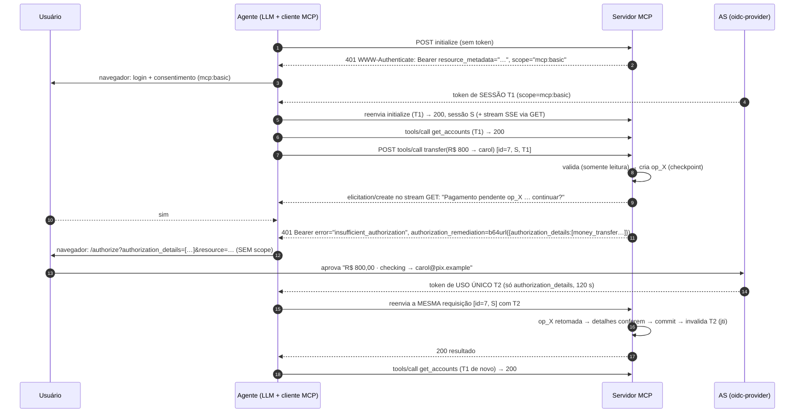

# MCP step-up lab: autorização por operação com remediação RAR

> English version: [README.md](README.md)

Um ambiente com docker compose para validar esta proposta. **Uma ferramenta (tool) MCP descobre _durante a execução_ que a operação precisa de autorização própria e responde com `401` + `WWW-Authenticate: Bearer error="insufficient_authorization", authorization_remediation=…`, conforme definido no [draft-ietf-oauth-rar-metadata-remediation](https://datatracker.ietf.org/doc/draft-ietf-oauth-rar-metadata-remediation/). O cliente retém a requisição em andamento, obtém um token de uso único contendo exatamente os `authorization_details` (RFC 9396) indicados na remediação e reenvia a mesma requisição.** A ferramenta não anuncia o requisito antecipadamente, e a elicitation nunca é o mecanismo de autorização.

* **Toda transferência exige um grant `money_transfer`**, cujos `authorization_details` fixam a conta de débito (debtor), o recebedor (chave Pix, creditor) e o valor.
* **Tokens de uso único (one-shot).** O token da operação **não tem scope** (nenhuma permissão anterior é solicitada de novo), vale 2 minutos e é invalidado pelo servidor MCP (pelo `jti`) quando a operação é efetivada. O agente o usa nesse único reenvio e o descarta.
* **O token de sessão é preservado.** O token `mcp:basic` obtido no login continua atendendo à consulta de saldos e a todas as outras chamadas. Ele nunca é substituído.
* **Desafio atômico.** Um 401 significa que nada foi executado, e um guard de commit garante isso.
* **Operações pendentes.** O reenvio retoma a operação a partir de um checkpoint, e um reenvio duplicado devolve o resultado armazenado.
* **Elicitation antes da autorização.** O usuário vê o que está pendente e confirma antes do redirecionamento para o navegador.

| Componente | Caminho | Papel |
|---|---|---|
| **IdP / AS** | `idp/` | [node-oidc-provider](https://github.com/panva/node-oidc-provider) 9.12 com RAR, o tipo `money_transfer`, uma tela de consentimento que exibe o pagamento e o `authorization_details_types_metadata_endpoint` |
| **Servidor MCP** | `mcp-server/` | Resource server Streamable HTTP (TS SDK 1.32), banco Pix de brinquedo, metadados RFC 9728, armazenamento de operações pendentes, remediação RAR |
| **Agente** | `agent/` | Loop de tool use com Claude sobre um cliente MCP que responde a elicitations de formulário e trata desafios Bearer (sessão e uso único) |



Uma versão detalhada em PlantUML está em `docs/stepup-sequence.puml`.

---

## Passo 0: pré-requisitos

* Docker Desktop (Compose v2.24+)
* Uma chave de API da Anthropic (só para o agente; o probe com curl não precisa)
* Portas 8080, 3000 e 8765 livres no host

```bash
cp .env.example .env     # coloque sua ANTHROPIC_API_KEY nele
```

## Passo 1: o AS (`idp/src`)

| Arquivo | O que faz |
|---|---|
| `money-transfer.js` | O tipo `money_transfer`: JSON Schema (servido pelo endpoint de metadados), um validador e um helper de exibição. Formato: `{type, debtor_account:{account_id}, creditor_account:{pix_key}, instructed_amount:{currency:"BRL", amount:"800.00"}}`. |
| `index.js` | Configuração do oidc-provider. `resourceIndicators` emite access tokens **JWT** com `aud = http://mcp-server:3000/mcp`: 600 s para o grant de sessão e 120 s para um grant de operação. `richAuthorizationRequests` valida o tipo, e o code e o token carregam **apenas os `authorization_details` da requisição atual**, então nada se acumula de grants anteriores. O discovery inclui `authorization_details_types_metadata_endpoint` → `GET /authorization-details-types`. Telas próprias de login e consentimento exibem o pagamento (valor, conta de débito, recebedor). Um password grant exclusivo do laboratório atende o probe sem navegador. |

* **Clientes:** `mcp-agent` (público, authorization code + PKCE, `authorization_details_types: ["money_transfer"]`) e `mcp-probe` (password grant, só para o laboratório).
* **Usuário:** `alice` / `alice`.
* **Separação de hostnames:** o issuer é `http://localhost:8080` para o navegador. Os containers acessam `http://idp:8080`, e o AS fixa no issuer todas as URLs que emite. O agente reescreve as chamadas de back-channel com `BACKCHANNEL_REWRITE`.

## Passo 2: o servidor MCP (`mcp-server/src`)

| Arquivo | O que faz |
|---|---|
| `auth.ts` | Valida os JWTs (iss, aud, assinatura) em toda requisição. Um token é ou um **token de sessão** (`mcp:basic`) ou um **token de uso único** (somente `authorization_details`). Também monta o desafio de remediação: `401`, `error="insufficient_authorization"`, `error_description` e `authorization_remediation=<JSON em base64url>` com os `authorization_details`. **Não há `authorization_reference`**, porque o draft manda omiti-lo para tokens de uso único. O `resource_metadata` é incluído para que o cliente encontre o AS. |
| `stepup.ts` | `requireAuthorizationDetails(extra, detalhe(s))` só passa se o token tiver detalhes idênticos e seu `jti` ainda não tiver sido consumido. Caso contrário, registra um desafio e interrompe a ferramenta. `commit()` envolve os efeitos colaterais; o **guard** se recusa a desafiar depois de um commit. `consumeToken()` invalida o token de uso único quando a operação é efetivada. |
| `operations.ts` | Armazenamento de operações pendentes, indexado por `(Mcp-Session-Id, id JSON-RPC)`: checkpoint, status, resultado armazenado, TTL. |
| `tools.ts` | `transfer`: valida (somente leitura), cria `op_X`, faz a **elicitation** de confirmação e então exige os detalhes `money_transfer` exatamente desta operação. No reenvio, retoma a partir do checkpoint, revalida, efetiva e invalida o token. `naive_batch_transfer` (demo): com um recebedor novo, cadastra o recebedor primeiro (um commit), então o guard devolve um resultado parcial. Com recebedores conhecidos, desafia uma única vez com **N `authorization_details`**, de modo que um consentimento cobre o lote. |
| `index.ts` | Modo de resposta JSON. Converte um desafio registrado no 401. Um token de uso único só é aceito em um `tools/call` de pagamento; qualquer outra coisa recebe `403 insufficient_scope`. As sessões ficam vinculadas ao `sub`. |

## Passo 3: o agente (`agent/src`)

| Arquivo | O que faz |
|---|---|
| `stepup-fetch.ts` | A metade cliente. **401 / 403 insufficient_scope** → (re)obtém o token de **sessão**, reenvia e continua usando-o. **401 insufficient_authorization** → decodifica o `authorization_remediation`, obtém um token de **uso único**, reenvia **apenas esta requisição** com ele e o descarta. Se o reenvio falhar de novo, o caso não é remediável e o cliente para (draft §7.1 passo 4, §7.3.3). |
| `oauth.ts` | Discovery (PRM → metadados do AS, verificação do issuer, verificação de `authorization_details_types_supported`). O fluxo authorization code + PKCE + `resource` é compartilhado pelo grant de sessão (`scope=…`) e pelo grant de operação (`authorization_details=…`, **sem scope**). O token de sessão nunca é sobrescrito por um token de operação. |
| `elicitation.ts` | Elicitation de formulário no terminal (`Y/n/c`). |
| `index.ts` | Loop de tool use com Claude. Declara a capability de elicitation, com timeout de 5 min para requisições retidas. |

## Passo 4: execute

```bash
docker compose down              # se a versão anterior (Keycloak) ainda estiver rodando
docker compose up -d --build
docker compose ps                # idp e mcp-server "healthy"

bash scripts/probe.sh            # prova via HTTP puro, sem LLM
docker compose run --build --rm --service-ports agent
```

O `probe.sh` mostra:

1. 401 sem token.
2. Com o token de sessão, uma transferência recebe **401 `insufficient_authorization`**. O script decodifica a remediação e obtém um token de uso único só com esses detalhes.
3. O token de uso único usado em `get_accounts` recebe **403**.
4. O reenvio retorna **200**.
5. Reenviar de novo devolve o resultado armazenado, sem débito em dobro.
6. A mesma transferência como uma requisição **nova**, com o token já consumido, recebe **401** de novo.
7. O lote ingênuo aciona o guard.
8. A consulta de saldos continua funcionando com o token de sessão.

No REPL do agente (pode escrever em português):

1. Faça login (`alice` / `alice`) e clique em **Allow** em "Read your accounts and balances".
2. `quais são meus saldos?`: usa o token de sessão.
3. `envie R$ 800 para carol@pix.example a partir da conta checking`: responda **y** na elicitation. O navegador mostra **"Approve this payment: R$ 800.00, checking → carol@pix.example"**. Aprove e a transferência é concluída. O log do agente mostra `one-shot token issued, scope=""`.
4. `e agora, quais são meus saldos?`: sem login e sem consentimento. O token de sessão é reutilizado.
5. `envie R$ 50 para bob@pix.example a partir da conta checking`: até um pagamento pequeno para um recebedor conhecido exige sua própria aprovação.
6. Teste **n** na elicitation (nada acontece) ou **Deny** no navegador (a chamada falha e o saldo não muda).

Logs: `docker compose logs -f idp mcp-server` mostra `[consent]`, `[token]` (scope e authorization_details de cada token), `[op]`, `[auth] one-shot token … consumed` e `[guard]`.

## O que o laboratório revelou (insumos para a proposta)

1. **A remediação RAR se encaixa bem no MCP.** O 401 traz tudo de que o cliente precisa para montar a requisição de autorização (`authorization_details`), e a RFC 9728 aponta para o AS. Não é preciso conhecer de antemão os requisitos da ferramenta. A escolha do draft pelo **401** (antes era 403) funciona aqui, porque o cliente distingue os casos pelo `error`.
2. **Modelo de dois tokens no cliente.** O cliente precisa manter um **token de sessão** de longa duração e tratar os tokens de remediação como **restritos à requisição**. Um SDK que guarda "o" token (como o `authProvider` atual) sobrescreveria o token de sessão por um token que não serve para mais nada. Isso deveria ser explicitado na especificação de autorização do MCP.
3. **Uso único exige estado no RS.** O OAuth não tem "access token de uso único". O laboratório chega a isso com TTL curto + ausência de refresh token + consumo do `jti` no RS + comparação exata dos detalhes. A regra do draft de omitir o `authorization_reference` para tokens de uso único é o que impede os clientes de armazená-los em cache.
4. **Regra do desafio atômico.** Um servidor NÃO DEVE (MUST NOT) enviar `insufficient_authorization` depois de efetivar efeitos colaterais daquela requisição. É isso que torna o reenvio seguro. Trabalho não atômico informa o progresso parcial na própria resposta (demo do guard).
5. **Identidade do reenvio.** `(sessão, id JSON-RPC)` permite que o servidor retome a operação do checkpoint e elimine reenvios duplicados. Um identificador explícito de operação seria mais robusto entre reconexões.
6. **O consentimento mostra a operação real.** Como o AS recebe os `authorization_details`, a tela de consentimento exibe valor, conta de débito e recebedor. A versão anterior, baseada em scopes, não conseguia fazer isso.
7. **Lote.** Uma única remediação pode carregar N `authorization_details`, então um consentimento e um token cobrem N transferências.
8. **Elicitation versus desafios HTTP.** No modo de resposta JSON, a elicitation precisa trafegar desvinculada da requisição pelo stream GET independente, porque o SDK descarta ali as mensagens do servidor vinculadas à requisição. A elicitation continua sendo só UX; a autorização vem do AS.
9. **Timeouts.** Uma requisição retida espera por uma pessoa, então o padrão de 60 s do SDK é curto demais.

## Solução de problemas

* **`invalid_authorization_details` vindo do AS.** Os detalhes não seguem o schema `money_transfer`. Veja `GET http://localhost:8080/authorization-details-types`.
* **O navegador diz "Unknown or already used state".** Você abriu uma URL de autorização antiga. Use a última que o agente imprimiu.
* **A elicitation nunca aparece e a chamada fica parada ~2 min.** O stream SSE via GET do cliente não está aberto. O servidor estoura o tempo e cancela a operação.
* **`invalid_token` depois de reiniciar o `idp`.** O AS gera uma nova chave de assinatura ao iniciar. Reinicie o agente para que ele faça login de novo.
* **O agente pede `scope=mcp:basic` em vez dos `authorization_details` numa transferência.** Você está rodando uma imagem antiga do agente. O serviço `agent` fica atrás de um profile, então `docker compose up --build` **não** o reconstrói, e `docker compose run` reaproveita a imagem antiga. Sempre inicie com `docker compose run --build …` (ou rode `docker compose --profile agent build`). A mensagem de inicialização precisa mencionar `RAR remediation client`.
* **`EACCES: permission denied, open '/app/src/index.ts'`.** Os arquivos-fonte estão com permissão só para o dono (`600`). Os Dockerfiles já usam `COPY --chown=node:node`; reconstrua as imagens com `docker compose --profile agent build`.
* **Zerar tudo.** `docker compose down && docker compose up -d`. Todo o estado fica em memória.
